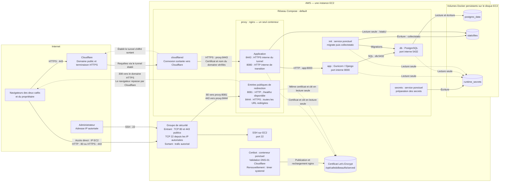
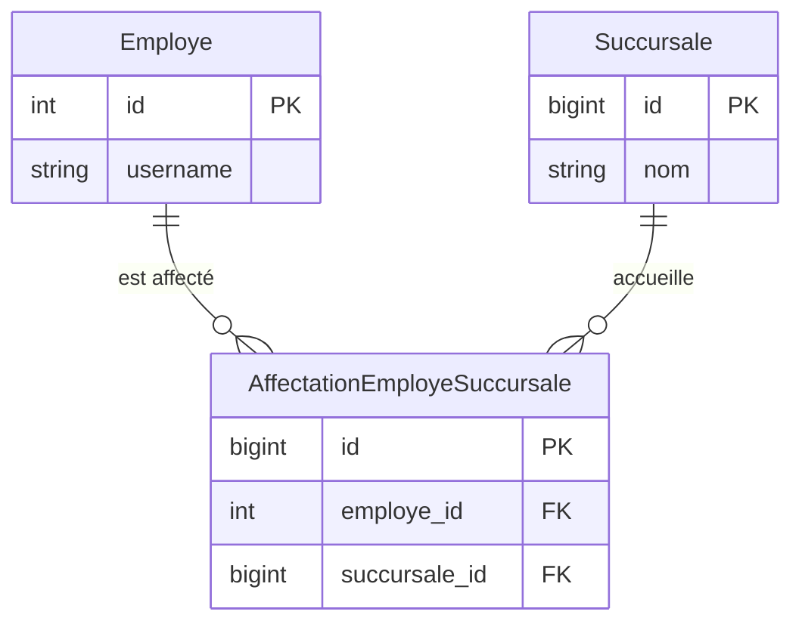

# Conception Café Dolbeau <!-- omit in toc -->


## Table des matières <!-- omit in toc -->


- [Implémentation](#implémentation)
  - [Structure du projet](#structure-du-projet)
  - [Déploiement AWS avec Cloudflare Tunnel et Nginx HTTPS](#déploiement-aws-avec-cloudflare-tunnel-et-nginx-https)
  - [Clients](#clients)
    - [Suppression d'un client](#suppression-dun-client)
    - [Fusion de deux clients](#fusion-de-deux-clients)
  - [Achat d'articles](#achat-darticles)
    - [Onzième café gratuit et cartes prépayées](#onzième-café-gratuit-et-cartes-prépayées)
      - [Calcul des cafés gratuits](#calcul-des-cafés-gratuits)
      - [Explication de la logique](#explication-de-la-logique)
        - [Tableau explicatif](#tableau-explicatif)
      - [Consommation](#consommation)
    - [Annuler une transaction](#annuler-une-transaction)
  - [Paramètres des cafés gratuits](#paramètres-des-cafés-gratuits)
  - [Création des rapports](#création-des-rapports)
  - [Gestion des permissions](#gestion-des-permissions)
  - [Gestion des différentes succursales](#gestion-des-différentes-succursales)
      - [Représentation graphique de la relation employé - succursale](#représentation-graphique-de-la-relation-employé---succursale)
    - [Gestion des rôles](#gestion-des-rôles)
      - [Tableau des permissions de Café Dolbeau](#tableau-des-permissions-de-café-dolbeau)
    - [Programme de fidélité](#programme-de-fidélité)
    - [Les rapports](#les-rapports)
- [Choix techniques](#choix-techniques)
  - [Centralisation de la logique métier](#centralisation-de-la-logique-métier)
  - [Cohérence des données](#cohérence-des-données)
  - [Migration des données (V1 -\> V2)](#migration-des-données-v1---v2)
  - [Migration des données (V2 -\> V3)](#migration-des-données-v2---v3)

## Implémentation

### Structure du projet

```text
.                               # Racine du projet
├── docker/                     # Conteneurs, Compose, nginx et Gunicorn
├── docs/                       # Documentation du projet
│   ├── adr/                    # Décisions d’architecture
│   ├── conception.md
│   ├── deploiement.md
│   └── migration.md
├── scripts/                    # Configuration, migration et données de démonstration
├── src/
│   ├── config/                 # Configuration Django et routes
│   ├── CafeDolbeau/            # Application Django
│   │   ├── admin/              # Administration des modèles
│   │   ├── forms/              # Formulaires
│   │   ├── management/commands/ # Commandes de soldes et de démonstration V3
│   │   ├── migrations/         # Migrations de la base de données
│   │   ├── static/             # Fichiers CSS et JavaScript
│   │   ├── templates/          # Pages et fragments HTML
│   │   ├── test/               # Tests Django
│   │   ├── tests_js/           # Tests JavaScript
│   │   ├── views/              # Vues Django
│   │   ├── models.py           # Modèles de données
│   │   ├── permissions.py      # Rôles et accès aux succursales
│   │   ├── promotions.py       # Promotions et compteurs associés
│   │   ├── rapports.py         # Calcul et export des rapports
│   │   └── services.py         # Logique métier des opérations
│   └── manage.py               # Commandes Django
├── .env.example                # Variables d’environnement documentées
├── .gitignore
├── AI-USAGE.md
├── README.md
└── requirements.txt            # Dépendances Python
```


### Déploiement AWS avec Cloudflare Tunnel et Nginx HTTPS

Le déploiement AWS est défini dans
[docker/compose.prod.yaml](../docker/compose.prod.yaml). Une seule instance EC2
héberge les conteneurs et leurs volumes persistants. Le domaine public est
publié par Cloudflare Tunnel ; son enregistrement DNS est un CNAME vers le tunnel.
La configuration locale reste dans [docker/compose.yaml](../docker/compose.yaml).



Une requête vers le domaine public passe du navigateur à Cloudflare en HTTPS.
Le conteneur `cloudflared` établit une connexion sortante chiffrée vers Cloudflare,
qui transmet les requêtes par ce tunnel à nginx en HTTPS sur `proxy:8443`.
Cloudflared vérifie le certificat Let's Encrypt avec le domaine public configuré
comme **Origin Server Name**. Le port `8080` reste disponible en interne pour la
transition HTTP et les contrôles de santé. Le tunnel ne
nécessite aucun port entrant dédié sur EC2. nginx transmet les requêtes applicatives
à Gunicorn, qui exécute Django ; Django consulte PostgreSQL au besoin. Les réponses
reviennent par le même chemin. nginx sert directement `/static/` depuis le volume
`staticfiles`.

Le groupe de sécurité autorise les ports 80 et 443 depuis Internet et le port 22
uniquement depuis les adresses IP administratives configurées. Le port 80 de
l’instance est publié vers `8081` : `/healthz` répond directement pour les contrôles
de santé, et les autres chemins redirigent vers le domaine HTTPS. Le port public
443 est publié vers `8444`, qui redirige toutes les URL vers ce même domaine avec
un statut 308, en conservant le chemin et les paramètres. Le navigateur suit alors
le chemin Cloudflare et tunnel ; nginx ne relaie pas lui-même la requête vers
Cloudflare. L’entrée interne `8443` sert l’application sans redirection, ce qui
évite une boucle. Les ports de Gunicorn et de PostgreSQL restent internes au
réseau Compose. La configuration des accès AWS est définie dans
[infra/app/main.tf](../infra/app/main.tf).

Certbot obtient le certificat par validation DNS-01 et le timer systemd vérifie
son renouvellement deux fois par jour. Les deux écoutes HTTPS de nginx utilisent
la même paire certificat/clé montée en lecture seule et rechargée après
renouvellement. Un accès HTTPS par IP affiche un avertissement avant la redirection,
car le certificat couvre le domaine et non l’IP. Les redirections publiques ne
fournissent pas d’accès de secours si Cloudflare est indisponible. Les détails DNS,
TLS et de redirection figurent dans le
[guide de déploiement](deploiement.md#42-redirections-des-accès-publics-ec2-vers-le-tunnel).

Lors du déploiement, `secrets` prépare les secrets, puis PostgreSQL démarre. Le
service `init` applique les migrations et collecte les fichiers statiques avant le
démarrage de Gunicorn, de nginx et du tunnel. Docker démarre au boot de l’instance
et les services permanents utilisent `restart: unless-stopped`. Un redémarrage de
l’instance réutilise les volumes et ne relance pas les services ponctuels terminés.
Les données, fichiers statiques et secrets sont conservés tant que les volumes et
le disque EC2 sont conservés.

### Clients


Un client est constitué des éléments suivants :

- **id** : La clé primaire du client.
- **nom_complet** : Le nom complet du client.
- **telephone** : Le numéro de téléphone du client (UNIQUE).
- **courriel** : Le courriel du client (UNIQUE).
- **nombre_cafes_prepayes** : Le nombre de cafés prépayés qu'il possède.
- **nombre_cafes_achetes** : Le nombre total de cafés achetés.
- **nombre_cafes_fidelite** : Le nombre d’achats admissibles à la fidélité habituelle, hors promotion.
- **nombre_cafes_gratuits** : Le nombre de cafés gratuits disponibles.
- **compteurs_promotion** : La relation vers les compteurs de cafés gratuits par promotion.
- **est_actif** : Indique si le client est actif.

Lors de l'inscription, le client doit donner son courriel ou son numéro de téléphone. Il est aussi possible de donner les deux.
Cette vérification est faite à l'aide de la redéfinition de la fonction `clean` de la classe `Model`.
On peut chercher un client à l'aide de l'un de ces trois champs : nom, téléphone ou courriel.
Le téléphone et le courriel permettent de distinguer deux homonymes.

Pour faciliter l'inscription des clients, nous avons choisi de permettre la création d'un compte aussi bien avec le téléphone qu'avec le courriel.
Pour les cafés, nous avons préféré en faire des attributs du client puisqu'au final, ce ne sont que des chiffres incrémentés et décrémentés. Cela ne servait à rien de complexifier notre BD avec des tables séparées.
Les cafés gratuits ont été mis à part puisqu'ils ne sont pas considérés dans le nombre total de cafés : ils n'ont pas été achetés.

Un client peut être désactivé, auquel cas aucune transaction ne peut être ajoutée sur son profil. S'il est désactivé : `est_actif = false` ; sinon : `est_actif = true`.

#### Suppression d'un client

Avant d'effectuer une suppression, on vérifie les permissions de l'employé. On s'assure également que le client ne participe pas à une fusion en cours et que ses compteurs n'ont pas été modifiés depuis la dernière confirmation.
La suppression se déroule comme suit :

1. S'il n'existe pas, on crée le client fictif avec l'ID `-1`, nommé `Client Supprimé`.
2. Les transactions du client à supprimer sont transférées au client fictif.
3. On enregistre la suppression dans le journal d'administration.
4. On supprime la fiche du client avec `delete()`.

#### Fusion de deux clients

Lors d'une fusion, deux clients doivent être sélectionnés et il faut choisir quel compte conserver pour la fusion. Le client conservé est appelé `client conservé` et l'autre `client source`.
Avant d'effectuer la fusion, on vérifie les permissions de l'employé. On s'assure également que les deux clients sont actifs, qu'aucune autre fusion en cours ne les concerne et que leurs compteurs n'ont pas été modifiés depuis la dernière confirmation.
La fusion se déroule comme suit :

1. Les compteurs des deux clients sont additionnés (aucun café gratuit n'est accordé).
2. Les transactions du `client source` sont transférées au `client conservé`.
3. Le client source est désactivé.

Le retour en arrière est possible tant qu'aucune transaction n'est effectuée sur le `client conservé`. À la suite d'une transaction, la fusion est définitive et le `client source` est supprimé.

### Achat d'articles

Lorsqu'un client achète un café, le modèle `TransactionCafe` est utilisé.
Ce modèle contient les attributs suivants :

- **type_transaction** : Permet de savoir si la transaction est un achat, un café prépayé, un café gratuit ou l'utilisation d'un café prépayé ou gratuit.
- **client** : ID du client.
- **client_origine_id** : Si un client est supprimé, cet attribut permet de le différencier des autres.
- **quantite** : Nombre de cafés.
- **date_creation** : Date de la transaction.
- **employe** : Employé ayant enregistré la transaction.
- **operation_id** : UUID commun aux lignes d’une même opération, permettant de les regrouper pour une annulation.
- **variation_achetes** : Variation du compteur de cafés achetés causée par cette transaction.
- **variation_prepayes** : Variation du compteur de cafés prépayés causée par cette transaction.
- **variation_gratuits** : Variation du compteur de cafés gratuits causée par cette transaction.
- **variation_fidelite** : Variation du compteur de fidélité normal causée par cette transaction
- **variation_progression_promotion** : Variation de la progression du client dans la promotion causée par cette transaction.
- **variation_gratuits_promotion** : Variation du nombre de cafés gratuits disponibles dans la promotion causée par cette ligne.
- **succursale** : L'id de la succursale dans laquelle la transaction a été effectué
- **promotion** : L'id de la promotion si il y a lieu, sinon null


Les variations mémorisent les effets de chaque ligne pour pouvoir les inverser lors d’une annulation. Une valeur positive ajoute des cafés, une valeur négative en retire et zéro laisse le compteur inchangé. Pour les anciennes transactions, ces champs peuvent être à `NULL` : leurs effets doivent alors être renseignés par un gérant avant l’annulation.

Le champ `type_transaction` permet de savoir quoi faire selon le type de transaction via la vue `ajouter_cafes_client`, qui utilise la fonction `ajouter_cafes`.

- **ACHAT** -> Achat classique : on incrémente de *quantite* le nombre de cafés et on vérifie si un café doit être gratuit.
- **PREPAYE** -> Ajout de *quantite* × 10 cafés prépayés au compte du client + *quantite* cafés gratuits.
- **GRATUIT** -> Affiche un message pour féliciter le client et ajoute un café gratuit.
- **UTILISE** -> Utilisation de *quantite* cafés prépayés.


#### Onzième café gratuit et cartes prépayées

##### Calcul des cafés gratuits

Hors promotion, le nombre de cafés gratuits accordés au client est calculé à partir du compteur de fidélité habituelle :

- **gratuit** : Nombre de cafés gratuits accordés lors de la transaction ;
- **total** : Valeur de `nombre_cafes_fidelite` avant la transaction ;
- **achat** : Nombre de nouveaux achats admissibles à la fidélité habituelle, excluant les cafés consommés à partir des réserves gratuites ou prépayées ;
- **regle** : Seuil de fidélité habituelle en vigueur, donné par `seuil_gratuite_actif`.

```math
gratuit = (total + achat)\;\mathrm{DIV}\;regle - total\;\mathrm{DIV}\;regle
```

Ce calcul se fait à l'aide de la méthode `calculer_cafes_gratuits` du modèle
[ParametresCafe](#paramètres-des-cafés-gratuits). Les étampes habituelles restantes
correspondent à `nombre_cafes_fidelite % seuil_gratuite_actif`.

Le compteur `nombre_cafes_achetes` conserve tous les achats, y compris ceux
effectués pendant une promotion. Pendant une promotion, ces achats font avancer
le compteur promotionnel et la fidélité habituelle reste inchangée. Par exemple,
un client ayant 9 achats admissibles qui achète 4 cafés en promotion passe à
13 achats au total, mais conserve 9 étampes habituelles pour un seuil de 10.


##### Explication de la logique

Initialement, les cafés gratuits étaient immédiatement consommés, mais pour laisser plus de flexibilité aux clients, nous avions migré les cafés gratuits vers les cafés prépayés. Lorsque 10 cafés étaient achetés, on ajoutait 1 au compteur prépayé. Pour améliorer la clarté visuelle et la compréhension, les cafés gratuits sont maintenant enregistrés dans leur propre compteur. Le café gratuit n'est jamais comptabilisé dans le total afin d'éviter un décalage qui pourrait priver le client d'un café gratuit. Les cafés gratuits n'expirent jamais.

Au début du projet, on ajoutait directement 11 cafés aux compteurs du total et des cafés prépayés, mais puisque nous avons changé la méthode pour calculer les cafés gratuits, cela causait un décalage.
Dans la V1, chaque carte prépayée contient 10 cafés et un café gratuit. Lors de l'achat d'une telle carte, 10 cafés sont ajoutés au compteur de cafés prépayés du client et un café est ajouté au compteur des cafés gratuits.
C'est toujours le cas dans la V2. Si la règle des cafés gratuits n'est pas égale au nombre de cafés prépayés par carte, le prix moyen du café sur la carte va différer de celui des achats courants.

###### Tableau explicatif

| Situation                             | Résultat attendu pour regle = 10                   |
| ------------------------------------- | -------------------------------------------------- |
| 9 achats admissibles, puis achat de 1 café hors promotion | Compteur de fidélité : 10 ; ajout de 1 récompense |
| Utilisation de cette récompense       | Solde gratuit diminué de 1 ; total acheté inchangé |
| Achat de 2 cartes                     | +20 prépayés, +2 gratuits             |

##### Consommation

Lorsqu'un client achète un café, il peut décider d'utiliser ou non ses cafés prépayés/gratuits. Les cafés gratuits sont consommés en premier, puis les cafés prépayés.
Un client peut décider d'utiliser seulement un certain nombre de cafés prépayés/gratuits et de payer le reste. Il suffit au caissier d'enregistrer une première opération, puis une seconde.

#### Annuler une transaction

Une annulation se déroule ainsi :

1. Une vérification des permissions est effectuée.
   - Si les transactions datent de la V1, seul le gérant peut les annuler.
2. Regroupement des lignes de la transaction grâce à leur UUID commun.
   - Si les transactions datent de la V1, c'est à l'employé de lier les transactions manuellement.
   - Si les paramètres de variation sont NULL, l'employé doit les spécifier.
3. Les opérations sont inversées dans le bon client.
   - Les compteurs ne descendent jamais sous 0.
4. L'annulation est enregistrée dans le modèle `AnnulationTransaction`.


### Paramètres des cafés gratuits

Pour simplifier la gestion des paramètres des cafés gratuits, une section complète a été ajoutée dans l'administration. Cette section découle du modèle `ParametresCafe`. Ce modèle a les attributs suivants :

- **id** : Identifiant numérique.
- **cafes_pour_gratuite** : Le nombre de cafés pour en avoir un gratuit (*quantite*).
- **cafes_pour_gratuite_precedent** : Le nombre précédent de cafés pour en avoir un gratuit.
- **date_application** : La date à laquelle on utilise `cafes_pour_gratuite` au lieu de `cafes_pour_gratuite_precedent`.

Il a les méthodes suivantes :

- `calculer_cafes_gratuits()` -> Permet de calculer le nombre de cafés gratuits à accorder
- `charger` -> Permet de charger le modèle en objet et de le retourner
- `seuil_gratuite_actif` -> Retourne le bon seuil de cafés selon la date courante

Il permet d'avoir une certaine flexibilité si de nouvelles règles ou contraintes doivent être implémentées.

### Création des rapports

Pour créer des rapports :

1. Le gérant doit sélectionner les types de transactions et la période.
2. Les paramètres sont validés à l'aide de la classe `RapportForm`.
3. Une requête récupère les informations associées aux paramètres sélectionnés.
4. Les quantités nettes sont calculées en soustrayant les quantités annulées des quantités enregistrées.
5. Les données sont regroupées dans un objet `Rapport` et les détails par transaction sont dans des objets `EvenementRapport`. Tous ces objets sont en mémoire ; aucun n'est en BD.
6. La vue transmet un résultat en HTML. Il est possible d'exporter le rapport en Excel grâce à la bibliothèque `openpyxl`.

### Gestion des permissions

Trois rôles applicatifs sont définis à l’aide des groupes et des permissions Django :

| Rôle | Permissions applicatives principales | Périmètre |
| --- | --- | --- |
| Barista | `acces_base` | Les succursales auxquelles il est affecté. |
| Gérant | `acces_base`, `acces_gerant` | Ses succursales pour les opérations, les annulations et les rapports. |
| Propriétaire | `acces_base`, `acces_gerant`, `acces_proprietaire` | Toutes les succursales, y compris celles créées ultérieurement, sans affectation nécessaire. |

Les décorateurs `@acces_base_requis`, `@gerant_requis` et `@proprietaire_requis`
protègent les vues selon le rôle. Pour les pages de caisse, `@succursale_requise`
vérifie aussi la succursale indiquée dans l’URL. Les fonctions
`succursales_autorisees` et `verifier_acces_succursale`, dans
[permissions.py](../src/CafeDolbeau/permissions.py), centralisent ce contrôle.

Les vérifications sont effectuées côté serveur. Le formulaire de connexion
refuse un employé sans accès à la succursale mémorisée pour la caisse. Les
services revérifient ses droits avant l’enregistrement, et les rapports avant
leur génération, afin de tenir compte d’un retrait d’affectation.

Dans l’administration, les méthodes comme `has_add_permission` et
`has_delete_permission`, les requêtes filtrées et les validations des formulaires
limitent les actions et les données accessibles. Le Propriétaire gère les
succursales, les comptes applicatifs, leurs rôles et leurs affectations. Un
Gérant ne peut créer que des Baristas et gérer leurs affectations dans son
périmètre. La fiche client reste commune au réseau, comme expliqué dans
l’[ADR-0010](adr/0010-ROLES.md).

Le Propriétaire est distinct du superutilisateur Django : il ne peut ni gérer
les comptes superutilisateurs ni modifier les privilèges techniques. Le premier
Propriétaire est désigné par un superutilisateur.

### Gestion des différentes succursales

La gestion des succursales se fait à l'aide des modèles `Succursale` et `AffectationEmployeSuccursale`.

Le choix d’identifier la succursale dans l’URL de la caisse est justifié dans
l’[ADR-0009 — Comment différencier deux succursales](adr/0009-SUCCURSALE.md). Se choix prend en compte que les employés ont accès au raccourcis de la caisse qui redirige vers le site web. Ils n'ont pas accès à l'URL. Dans un cas réel, on aurait planifié l'utilisation d'un VPN pour éviter que n'importe qui puisse accéder à l'application et on baserait la succursale selon l'ip de la caisse.

Une succursale est constituée des attributs suivants :

- **id** : La clé primaire de la succursale.
- **nom** : Le nom attribué à la succursale.

Le modèle `AffectationEmployeSuccursale` permet de garder une trace des lieux de travail de chaque employé. Ce modèle est constitué des attributs suivants :

- **id** : La clé primaire de la relation entre un employé et une succursale.
- **employe_id** : Une clé étrangère qui permet de retrouver l'employé.
- **succursale_id** : Une clé étrangère qui permet de retrouver la succursale.

On peut représenter cette relation entre un employé et une succursale de la manière suivante :

##### Représentation graphique de la relation employé - succursale


#### Gestion des rôles

Cette relation est, entre autres, utile pour empêcher un gérant de consulter ou de gérer une succursale qui ne fait pas partie de son périmètre. En effet, avec l'arrivée des succursales et du rôle de **Propriétaire**, la gestion des permissions devient plus restrictive. Il faut vérifier si l'employé peut accéder au *tableau de bord* de la succursale et aux autres fonctionnalités. 

##### Tableau des permissions de Café Dolbeau

| Fonction                                    | Propriétaire     | Gérant          | Barista                                                    |
| ------------------------------------------- | ---------------- | --------------- | ---------------------------------------------------------- |
| Dix dernières transactions d’un client      | Tout le réseau   | Tout le réseau  | Tout le réseau                                             |
| Enregistrer une opération                   | Toute succursale | Ses succursales | Ses succursales                                            |
| Annuler une transaction                     | Tout le réseau   | Ses succursales | Ses propres transactions récentes, dans la succursale active |
| Liste des transactions dans l’administration | Tout le réseau   | Ses succursales | Aucun accès                                                |
| Rapports et exports, provisoirement         | Tout le réseau   | Ses succursales | Refusés                                                    |

#### Programme de fidélité

La gestion des promotions et de leurs compteurs partagés entre les succursales
participantes est justifiée dans l’[ADR-0011 — Gestion de la fidélité avec plusieurs succursales](adr/0011-PROMOTIONS.md).

Le programme de fidélité reste semblable à celui des versions précédentes, à l'exception de l'ajout d'une nouvelle catégorie : les **promotions**. Les promotions remplace le programme standard pendant toute sa durée de vie. Elles sont attribuées directement aux succursales participantes. Les promotions fonctionnent à l'aide des trois modèles suivants : `Promotion`, `PromotionSuccursale` et `CompteurPromotion`.

Le modèle `Promotion` est constitué des attributs suivants :

- **id** : La clé primaire.
- **nom** : Le nom donné à la promotion.
- **cafes_pour_gratuite** : Le nombre de cafés à acheter pour en obtenir un gratuit pendant la promotion.
- **date_debut** : La date de début de la promotion.
- **date_fin** : La date de fin de la promotion.
- **annulee_le** : La date d'annulation de la promotion (`NULL` si elle n'est pas annulée).
- **annulee_par** : L'identifiant de l'employé qui a annulé la promotion (`NULL` si elle n'est pas annulée).
- **motif_annulation** : Le motif de l'annulation, par exemple : « La compagnie partenaire est associée à XQC » (chaîne vide si aucun motif n'est renseigné).

Pour affecter les promotions aux succursales, le modèle `PromotionSuccursale` est utilisé. Ce modèle est constitué des attributs suivants :

- **id** : La clé primaire.
- **promotion_id** : L’identifiant de la promotion référencée par la clé étrangère `promotion`.
- **succursale_id** : L’identifiant de la succursale participante référencée par la clé étrangère `succursale`.

Lorsqu'une promotion est affectée à une succursale, elle ne peut pas être retirée d'une seule succursale pendant sa période de validité. Ce choix a été fait pour éviter certaines confusions chez les clients. Soit on l'annule pour toutes les succursales, soit on ne l'annule pas. En cas d'annulation, le propriétaire qui l'a annulée est enregistré, ainsi que la date et le motif de l'annulation.

Chaque promotion a son propre compteur, indépendant du compteur de base des cafés gratuits. Pour faire le lien avec les clients, le modèle `CompteurPromotion` est utilisé. Ce modèle est constitué des attributs suivants :

- **id** : La clé primaire.
- **promotion_id** : L’identifiant de la promotion référencée par la clé étrangère `promotion`.
- **client_id** : L’identifiant du client référencé par la clé étrangère `client`.
- **cafes_gratuits** : Nombre de café gratuit obtenu dans la promotion
- **progression** : Nombre de café accumulés pour la promotion


De cette manière, un même client peut profiter de la même promotion dans les différentes succursales participantes et de plusieurs promotions en même temps.

#### Les rapports

L’attribution des transactions aux rapports de chaque succursale, notamment pour
les cafés gratuits gagnés et utilisés dans des cafés différents, est justifiée
dans l’[ADR-0012 — Gestion des rapports avec plusieurs succursales](adr/0012-RAPPORTS_SUCCURSALES.md).

La gestion des rapports comprend une section supplémentaire : la sélection des succursales. Un gérant a accès aux succursales de son périmètre, tandis qu'un propriétaire a accès à toutes les succursales. Dans le rapport, la synthèse et le détail des totaux sont présentés séparément pour chaque succursale sélectionnée, puis pour l'ensemble de la sélection.


## Choix techniques

### Centralisation de la logique métier

Les opérations sur les cafés, les annulations, les suppressions et les fusions sont centralisées dans [services.py](../src/CafeDolbeau/services.py).

### Cohérence des données

Les opérations qui modifient plusieurs données utilisent la fonction `_avec_clients_verrouilles`. Celle-ci utilise `transaction.atomic()` pour garantir que toutes les données sont enregistrées ou que l'opération est complètement annulée. Cela évite de modifier les compteurs d'un client sans enregistrer la transaction correspondante.


### Migration des données (V1 -> V2)

Pour préserver l'intégrité des données de la `V1`, les champs ajoutés acceptent la valeur `NULL`. Les opérations qui nécessitent ces champs ajoutés se font manuellement pour les lignes qui datent de la `V1`.

### Migration des données (V2 -> V3)

Pour préserver l'intégrité des données de la `V2`, les transactions sont tous enregistrés comme étant dans la succursale #1. Tous les employés sont attribués à la succursale #1. Pour les autres attributs qui peuvent être nullable qui ont étés ajoutés ils sont mis à NULL.

Les étapes, les précautions et les résultats de notre vérification sont
présentés dans la [procédure de migration V2 → V3](migration.md#migrer-les-données-de-la-v2-vers-la-v3).
